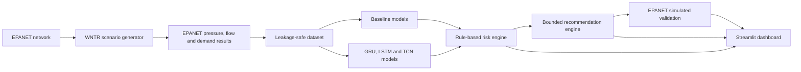

# AquaBalance

**Deep Learning--Assisted Prediction and Control Recommendation for
Junction-Level Pressure Imbalance in Water Distribution Networks**

> **Safety notice:** AquaBalance is a simulation-based decision-support
> prototype. It is not designed to control a real water utility or any
> physical equipment.

All project data is generated through hydraulic simulations using
**EPANET via WNTR**. The project does not use real utility data, live
sensors, or real pumps and valves. Validation means re-running scenarios
inside the simulated EPANET network; it is **not field validation**.

AquaBalance forecasts pressure at three consumer junctions 15 minutes
ahead, assigns transparent risk labels, proposes small bounded pump or
valve adjustments, and checks candidate adjustments by re-running the
scenario in EPANET. The objective is to keep pressure within configured
safe ranges and limit excessive pressure spread---not to make pressure
identical at every junction.

**EPANET is the required hydraulic simulator. There is no fallback
simulator.**

<<<<<<< Updated upstream
**EPANET is the mandatory primary hydraulic simulator.** There is no fallback simulator.

=======
>>>>>>> Stashed changes
## Contents

-   [Overview and architecture](#overview-and-architecture)
-   [Network model](#network-model)
-   [Methodology](#methodology)
-   [Results](#results)
-   [Installation](#installation)
-   [Quick start](#quick-start)
-   [Pipeline commands](#pipeline-commands)
-   [Pipeline details](#pipeline-details)
-   [Dashboard](#dashboard)
-   [Repository layout](#repository-layout)
-   [Limitations](#limitations)
-   [Ethics and safety](#ethics-and-safety)
-   [Future work](#future-work)
-   [Troubleshooting](#troubleshooting)

## Overview and architecture

AquaBalance combines hydraulic simulation, time-series forecasting,
rule-based risk assessment, bounded recommendations, and simulator-based
validation.



The workflow is:

1.  Build the hydraulic network.
2.  Generate reproducible scenarios with WNTR and solve them using
    EPANET.
3.  Build a dataset that avoids scenario leakage between train,
    validation, and test splits.
4.  Compare persistence, rule-based, random-forest, GRU, LSTM, and TCN
    approaches where applicable.
5.  Convert forecasts into transparent risk labels.
6.  Suggest a bounded action or recommend inspection.
7.  Re-run candidate actions in EPANET and reject unsafe candidates.
8.  Present forecasts, risks, recommendations, and validation results in
    Streamlit.

### Sensors and actuators

-   **Measured inputs:** pressure, flow, demand, reported pump speed,
    and valve setting.
-   **Actuators represented in the simulation:** pump speed and
    pressure-reducing valve (PRV) setting.
-   **Important distinction:** sensors measure conditions; they do not
    equalize pressure. The recommendation engine only suggests changes
    in simulation and is not connected to physical equipment.

## Network model

The teaching network contains four junctions, four pipes, one pump, one
pressure-reducing valve, and no tank.

``` text
                         valve V1 (PRV)
R1 --PU1--> JP1 --P1--> J1 ----P2----> JV1 ==V1==> J2 (residential)
 reservoir   pump       hub   |
                              +--P3--> J3 (school)
                              +--P4--> J4 (hospital / critical service)
```

JP1 and JV1 are zero-demand helper nodes placed on either side of the
pump and valve. J1 is a hub without customers. J2, J3, and J4 are the
consumer junctions used for pressure forecasting and risk assessment. J4
is treated as the critical-service junction.

The network has no tank. A temporary reduction in source head represents
reduced supply; `tank_level` is intentionally absent rather than
fabricated.

## Methodology

### 1. Scenario generation

WNTR configures scenarios and runs EPANET; EPANET computes the resulting
hydraulic pressures and flows. Randomness selects scenario settings, not
pressure or flow values.

The nine scenario families are:

-   Normal operation
-   High-demand stress
-   High source pressure / fast pump
-   Valve misconfiguration
-   Reduced supply
-   Small leak
-   Burst leak
-   Pump degradation
-   Partial blockage

Each standard scenario represents 24 hours at 15-minute intervals.
Scenario specifications are stored in
`data/synthetic/scenario_specs.jsonl` so they can be reproduced. The
generator uses pressure-driven demand, EPANET emitters for leaks, and
records failed or invalid simulation attempts.

### 2. Risk labels and thresholds

The configurable lab-prototype thresholds in `config/config.yaml` are:

  Setting                                      Prototype value
  ------------------------------------------ -----------------
  Minimum consumer-junction pressure                      20 m
  Maximum consumer-junction pressure                      60 m
  Minimum pressure at critical junction J4                30 m
  Maximum allowed spread across J2--J4                    20 m

These are **teaching values, not universal water-utility standards**.
Pressure imbalance means the spread across the consumer junctions
exceeds the configured limit; it does not mean that all junctions should
have equal pressure. Elevation and demand naturally cause pressure
differences.

Risk flags can include low pressure, high pressure, pressure imbalance,
leak-like events, and burst-like events. The primary `risk_label`
priority is: `burst_like_event`, `leak_like_event`, `low_pressure_risk`,
`high_pressure_risk`, `pressure_imbalance`, then `normal`.

### 3. Dataset construction and leakage prevention

The forecasting task is to use the previous 12 time steps (three hours)
of sensor/control features to predict pressure at J2, J3, and J4 one
step (15 minutes) ahead.

The dataset process follows these rules:

-   Split whole scenarios 70/15/15, stratified by scenario family.
-   Never create a window across scenario boundaries.
-   Fit scalers using training scenarios only.
-   Keep scenario type, leak flag, and leak severity out of model
    inputs.
-   Drop features that the network does not produce, such as
    `tank_level`, and record the feature list.
-   Keep the split manifest and scenario specifications for
    reproducibility.

### 4. Forecasting models

The project compares:

-   **Persistence:** next pressure equals current pressure.
-   **Rule-based baseline:** judges current pressure against configured
    thresholds; it is reactive, not predictive.
-   **Random forest:** multi-output model using lag, difference, and
    rolling features.
-   **GRU:** gated recurrent unit sequence model.
-   **LSTM:** long short-term memory sequence model.
-   **TCN:** temporal convolutional network using causal dilated
    convolutions and residual blocks.

The neural models use the same input features, data splits,
loss/optimisation setup, seed policy, and evaluation metrics. They have
similar parameter counts, so the comparison is intended to be fair. No
model is assumed to be best in advance.

### 5. Risk engine

The rule-based risk engine combines forecast pressures with recent flow
and demand, pump speed, and valve setting. It produces fields such as:

-   `predicted_risk_label`
-   `low_pressure_nodes` and `high_pressure_nodes`
-   `pressure_spread` and `pressure_imbalance_flag`
-   `possible_leak_pattern_flag`
-   `severity_score` (0--100)
-   A plain-language explanation

J4 has a stricter minimum-pressure threshold, and an early warning is
raised when its forecast is within 2 m of that threshold. A leak-like
pattern requires both a pressure drop and an inflow-minus-metered-demand
mismatch. A mismatch without a pressure drop is treated as uncertain.
Hidden labels are not supplied to the engine.

### 6. Bounded recommendation engine

The recommendation engine suggests a small pump-speed or valve-setting
adjustment, or recommends inspection instead. The simulated bounds are
approximately ±10% for the pump and ±15% for the valve, with discrete
candidate steps.

Safety rules include:

-   Leak-like and burst-like patterns lead to inspection
    recommendations, not blind control changes.
-   J4's critical pressure requirement must not be sacrificed to improve
    another junction.
-   Uncertain or missing data leads to a conservative
    no-action/inspection recommendation.
-   If no candidate meets the safety checks, the system reports:
    `No safe action found; operator inspection recommended.`
-   The confidence score is rule-based; it is not a probability.
-   The expected-effect estimate is approximate. EPANET re-simulation,
    not the estimate, is used to assess the candidate.

### 7. EPANET simulated validation

The validator reloads the base network, reapplies the scenario, and runs
the baseline and candidate actions in EPANET. It considers bounded pump
and valve changes, scores the results, and rejects candidates that
worsen a node or violate J4's safety floor. Leak-like, burst-like, and
uncertain cases remain inspection-only.

Validation can report a full improvement, partial improvement, no safe
action, inspection-only, or no action needed. Results are reported even
when the recommendation does not improve every constraint.

> This is validation inside the simulator used to generate the data. It
> is not evidence of performance in a real water distribution network.

## Results

The reported test split contains 45 scenarios that were not used for
training. Metrics below are for 15-minute-ahead pressure prediction at
J2, J3, and J4. Full tables are generated in
`outputs/reports/final_results_summary.md`.

  Model             Parameters   Test MAE (m)   Test RMSE (m)   Risk macro F1
  --------------- ------------ -------------- --------------- ---------------
  Persistence              ---         0.1310          0.6286          0.9923
  Random forest            n/a     **0.0645**          0.4389          0.9983
  GRU                   26,691         0.1028          0.5646          0.9962
  LSTM                  26,723         0.1052          0.5840          0.9944
  TCN                   26,009         0.0875          0.5005          0.9974

Key observations:

-   The random forest achieved the lowest test MAE in this synthetic
    task; none of the neural networks outperformed it.
-   The TCN was the strongest of the three neural models, including
    across additional seeds; the GRU and LSTM results were close.
-   In 23 EPANET simulated recommendation validations, 11 improved the
    simulated network (one fully resolved the problem and ten partially
    improved it), five needed no action, two had no safe action, and
    five were inspection-only.
-   These results describe this small simulated network only. They do
    not establish real-world utility performance.

## Installation

### Requirements

-   Python. The project was developed and tested on Python 3.13 on
    Linux, but WNTR includes compiled components. **Python 3.11 or 3.12
    is the safer starting point** if a compatible prebuilt WNTR package
    is unavailable for your environment.
-   Git.
-   EPANET through WNTR, installed through the project requirements.
-   PyTorch for GRU, LSTM, and TCN training; it is optional for the
    baseline pipeline.

### Set up the environment

``` bash
git clone https://github.com/suhaantpatel/aquabalance.git
cd aquabalance

python -m venv .venv

# Linux / macOS
source .venv/bin/activate

# Windows PowerShell
# .venv\Scripts\Activate.ps1

python -m pip install --upgrade pip
python -m pip install -r requirements.txt
python -m pip install -r requirements-deep.txt  # Optional: PyTorch models

python -c "import wntr; print('WNTR', wntr.__version__)"
```

Run commands from the repository root---the directory containing
`config/`. Use `python -m pip` and `python -m streamlit` so they use the
active Python environment.

Without PyTorch, you can still build the network, generate EPANET
scenarios, train and use baseline models, run the risk and
recommendation engines, perform EPANET validation with a baseline
forecast, and use the dashboard. Neural models may be shown using saved
demo forecasts when `data/sample/` is available.

## Quick start

For a small installation smoke test:

``` bash
python scripts/build_network.py
python scripts/generate_synthetic_data.py --mode quick
python -m pytest tests -q
```

For the standard pipeline, follow the phases below in order. Some later
phases depend on outputs from earlier phases.

## Pipeline commands

Run these from the repository root.

  -------------------------------------------------------------------------------------------------------------
  Phase                   Purpose                 Command
  ----------------------- ----------------------- -------------------------------------------------------------
  1                       Build the EPANET        `python scripts/build_network.py`
                          network and topology    
                          figure                  

  2                       Generate 300 scenarios  `python scripts/generate_synthetic_data.py --mode standard`

  3                       Build the leakage-safe  `python scripts/build_ml_dataset.py`
                          ML dataset              

  3                       Train and score         `python scripts/train_baselines.py`
                          baseline models         

  4                       Train the GRU           `python scripts/train_gru.py`

  5                       Demo the risk engine    `python scripts/demo_risk_engine.py`
                          and recommendations     

  6                       Validate                `python scripts/validate_recommendation.py`
                          recommendations in      
                          EPANET                  

  7                       Build saved dashboard   `python scripts/build_demo_sample.py`
                          demo data (optional)    

  7                       Launch the dashboard    `python -m streamlit run app/app.py`

  8                       Train LSTM and TCN and  `python scripts/train_sequence_models.py`
                          update comparisons      

  8                       Test model robustness   `python scripts/seed_robustness.py`
                          across additional seeds 
                          (optional)              

  8                       Generate final reports  `python scripts/generate_final_reports.py`
                          and viva notes          

  All                     Run tests               `python -m pytest tests -q`
  -------------------------------------------------------------------------------------------------------------

Standard scenario generation creates 300 scenarios; quick mode creates
50. Approximate timings depend on the machine.

## Pipeline details

### Phase 1 --- Build the network

``` bash
python scripts/build_network.py
python -m pytest tests/test_network.py -v
```

Creates `data/raw/aquabalance_base.inp` and
`outputs/figures/network_topology.png`. Network values---including
elevations, demands, pipes, reservoir head, pump and valve defaults, and
pressure thresholds---are configured in `config/config.yaml`.

### Phase 2 --- Generate synthetic scenarios

``` bash
# Quick mode: 50 scenarios
python scripts/generate_synthetic_data.py --mode quick

# Standard mode: 300 scenarios
python scripts/generate_synthetic_data.py --mode standard

# Optional parameters
python scripts/generate_synthetic_data.py --mode standard --seed 7 --n 120
python -m pytest tests -v
```

The data is generated by EPANET hydraulic simulation, not by inventing
pressure values. WNTR applies settings such as source head, pump speed,
PRV setting, demand patterns, leaks, and partial blockages. EPANET 2.2
solves each 24-hour scenario at 15-minute intervals. Each scenario has
96 retained time steps; the extra row at 24:00 is dropped. Failed or
invalid simulations are retried and recorded.

Key outputs:

  -------------------------------------------------------------------------------
  File                                        Contents
  ------------------------------------------- -----------------------------------
  `data/synthetic/scenario_metadata.csv`      Settings for each scenario

  `data/synthetic/raw_timeseries.csv`         EPANET pressures, flows, and
                                              demands

  `data/synthetic/labels.csv`                 Time-step risk flags and labels

  `data/synthetic/scenario_specs.jsonl`       Reproducible scenario
                                              specifications

  `data/synthetic/demand_profiles.csv`        Demand multipliers by profile

  `outputs/simulations/summary.csv`           Scenario status and EPANET warnings

  `outputs/simulations/network_config.json`   Network configuration, units,
                                              thresholds, and provenance

  `outputs/logs/scenario_generation.log`      Scenario settings and generation
                                              status
  -------------------------------------------------------------------------------

In `scenario_metadata.csv`, `leak_severity` is the nominal leak at 50 m
pressure. In `raw_timeseries.csv`, the leak flow is the value EPANET
actually computed. Leak times are expressed in hours from the start of
the scenario.

### Phase 3 --- Build the ML dataset and train baselines

``` bash
python scripts/generate_synthetic_data.py --mode standard
python scripts/build_ml_dataset.py
python scripts/train_baselines.py
python -m pytest tests -v
```

The task is to predict pressure at J2, J3, and J4 15 minutes ahead from
the preceding 12 time steps. Window size, forecast horizon, target
nodes, and features are configurable under `ml:` in
`config/config.yaml`.

Baseline models:

1.  **Persistence:** predicts that next-step pressure will equal current
    pressure.
2.  **Rule-based:** checks current pressure against thresholds; it is
    reactive rather than predictive.
3.  **Random forest:** uses lag, difference, and rolling features to
    predict pressure changes.

Generated outputs include processed `.npz` data, scalers under
`models/scalers/`, the trained random forest under `models/trained/`,
baseline metrics and error analysis under `outputs/reports/`, and
figures under `outputs/figures/`.

### Phase 4 --- Train the GRU

``` bash
python scripts/train_gru.py
python scripts/train_gru.py --epochs 5  # Short smoke run
python -m pytest tests -v
```

The GRU takes sensor/control history with shape `(batch, 12, 18)`,
passes it through GRU layers of sizes 64 and 32 with dropout, and
predicts three pressure changes. A dense layer maps the final
representation to J2, J3, and J4 forecasts. Training uses Adam, a
learning rate of 0.001, Huber loss by default, batch size 64, early
stopping, and a learning-rate scheduler. The best checkpoint is selected
by validation MAE before test evaluation.

The model predicts a change from current pressure and adds it back,
matching the random-forest approach. Scenario type, leak flags, and leak
severity are not inputs.

Outputs include the model checkpoint and configuration under
`models/trained/`, metrics and comparison files under
`outputs/reports/`, and training/prediction/error figures under
`outputs/figures/`.

Risk labels used for scoring are derived from the true future EPANET
pressure. The dashboard must derive displayed risk from predicted
pressure.

### Phase 5 --- Risk analysis and recommendations

``` bash
python scripts/demo_risk_engine.py
python -m pytest tests -v
```

The risk engine in `src/risk_engine.py` derives the risk label, affected
nodes, pressure spread, imbalance flag, possible leak pattern, severity
score, and explanation from sensor/control history and the forecast.

The recommendation engine in `src/recommendation_engine.py` returns the
proposed action type, target component, current and recommended values,
adjustment percentage, rationale, safety note, confidence score, and
expected effect. Its priority order is burst-like event, leak-like
event, critical low pressure at J4, other low pressure, high pressure,
and imbalance.

The suggested action is bounded. Candidate steps include valve changes
of ±5%, ±10%, and ±15%, and pump changes of +5%, +10%, and −5%, within
configured bounds. Leak-like or burst-like cases lead to inspection
rather than blind control changes. If data is uncertain or no safe
action is available, the system recommends no action/inspection.

The expected effect is a first-order estimate based on the configured
pump curve and PRV behaviour; it is not itself a simulation. The PRV
serves the J2 branch, so J3 and J4 can only be adjusted through the
pump.

### Phase 6 --- Validate recommendations in EPANET

``` bash
python scripts/validate_recommendation.py
python scripts/validate_recommendation.py --scenario S0015 --step 51
python -m pytest tests/test_epanet_validation.py -v
```

Validation uses a fresh copy of `data/raw/aquabalance_base.inp`,
reapplies the selected scenario, and records baseline metrics for the
next hour (four time steps). It evaluates bounded pump and valve
candidates, rejects candidates that worsen any node or violate J4's
critical pressure floor, and selects a safe candidate only when the
configured objective and checks are satisfied. Leak-like, burst-like,
and uncertain cases are inspection-only.

The objective penalises high-pressure violations, low-pressure
violations, branch pressure spread, and control-change size, with large
penalties for critical J4 violations and imbalance. If no candidate
qualifies, the output is
`No safe action found; operator inspection recommended.`

Outputs include:

-   `outputs/simulations/recommendation_validation_results.csv`
-   `outputs/simulations/recommendation_candidate_search.csv`
-   `outputs/reports/recommendation_effectiveness.csv`
-   `outputs/figures/before_after_pressure_comparison.png`
-   `outputs/figures/before_after_violation_comparison.png`

Not every recommendation improves every scenario. The reports retain
partial improvements, inspection-only cases, no-action cases, and cases
where EPANET does not confirm the suspected problem.

### Phase 7 --- Launch the Streamlit dashboard

``` bash
python -m pip install -r requirements.txt
python -m streamlit run app/app.py
```

The dashboard reads saved simulation data and trained models, runs the
risk and recommendation engines, and performs EPANET simulated
validation when requested. It does not introduce a separate hydraulic or
forecasting pipeline.

The single-page dashboard includes:

-   System overview and network diagram
-   Pressure, flow, and demand trends
-   Next-step pressure forecasts and risk analysis
-   Recommended action and rationale
-   Before/after EPANET simulated validation
-   Model comparison
-   Plain-language methodology

Persistence, Random Forest, GRU, LSTM, and TCN appear when their
required artefacts are available. If PyTorch or a checkpoint is
unavailable, neural models can be shown from stored demo forecasts.

If full pipeline outputs are missing, the app can use `data/sample/` and
label the view **Synthetic EPANET simulation example**. To force demo
mode:

``` bash
AQUABALANCE_FORCE_DEMO=1 python -m streamlit run app/app.py
```

Rebuild the sample after retraining with:

``` bash
python scripts/build_demo_sample.py
```

The dashboard explicitly indicates that the network has no tank rather
than inventing a tank-level value.

Test the dashboard with:

``` bash
python -m pytest tests/test_app.py -v
```

### Phase 8 --- Compare sequence models and generate final reports

``` bash
python scripts/train_sequence_models.py
python scripts/seed_robustness.py       # Optional; takes longer
python scripts/generate_final_reports.py
python -m pytest tests -q
```

This phase trains LSTM and TCN models using a comparable data split and
training setup, updates the model comparison, and generates reports and
figures. The LSTM and TCN have parameter counts similar to the GRU.
Outputs include `model_comparison.csv`, `final_results_summary.md`,
`scenario_error_analysis.csv`, `recommendation_effectiveness_report.md`,
`limitations.md`, and `viva_preparation.md` under `outputs/reports/`,
plus figures under `outputs/final_figures/`.

### Open the network in the EPANET GUI

1.  Install EPANET 2.2 from the [US EPA
    website](https://www.epa.gov/water-research/epanet).
2.  Open `data/raw/aquabalance_base.inp` in EPANET.
3.  Select **Project → Run Analysis** and inspect node pressures in the
    Browser panel.

The network file uses litres per second (LPS). The official EPANET GUI
is a Windows application; on macOS or Linux, the GUI may be run through
Wine, or the `.inp` file can be used directly from Python via WNTR and
EPANET.

## Repository layout

``` text
config/config.yaml        Network, thresholds, scenarios, models, engines and validation settings
src/                      Network builder, simulation, scenario generator, labels, feature engineering,
                          preprocessing, dataset builder, models, training, evaluation, risk engine,
                          recommendation engine, EPANET validator and dashboard helpers
scripts/                  Scripts for each pipeline phase
app/                      Streamlit dashboard
tests/                    Pytest suites
data/raw/                 Base EPANET .inp network
data/sample/              Small saved example for dashboard demo mode
data/synthetic/           Generated scenarios and time-series data
data/processed/           Processed model datasets
models/scalers/            Fitted scalers
models/trained/            Trained models
outputs/figures/           Phase figures
outputs/final_figures/     Final report figures
outputs/reports/           Generated metrics, summaries, limitations and viva notes
outputs/simulations/       Scenario and recommendation validation results
outputs/logs/              Scenario-generation logs
```

Generated data, trained models, and most CSV reports are git-ignored and
can be rebuilt using the commands in this README. Selected final
markdown reports and figures may be tracked by Git.

## Limitations

-   **Synthetic data only:** the project uses a four-junction teaching
    network without a tank.
-   **Idealised scenarios:** the nine scenario families use defined
    ranges; real faults can be more complex.
-   **Simulator-only validation:** validation takes place in the same
    simulator used to generate the data and may be optimistic. It is not
    field validation.
-   **Short forecast horizon:** the model predicts one step (15 minutes)
    ahead from a three-hour history.
-   **Simple models are strong baselines:** the random forest achieved
    the lowest test error in the reported experiment; neural networks
    are comparators, not proven improvements.
-   **Prototype thresholds:** pressure limits are configurable lab
    values, not universal utility standards.
-   **Rule-based recommendations:** first-order effect estimates can be
    wrong; EPANET re-simulation is the validation step.
-   **Leak localisation is not established:** leak-like patterns trigger
    inspection recommendations only.
-   **No hardware integration:** no SCADA connection, physical sensors,
    actuator interface, or real operator workflow is included.

See `outputs/reports/limitations.md` for the generated limitations
report.

## Ethics and safety

-   **Never connect this prototype to real equipment.** Real water
    systems affect public health and must be operated by qualified
    personnel under utility procedures.
-   **Keep a human in the loop.** Recommendations include a rationale,
    safety note, and rule-based confidence score; a person remains
    responsible for decisions.
-   **Prioritise safety.** J4 is not sacrificed to improve another
    junction. Changes are bounded, leak-like and burst-like patterns
    trigger inspection, and unsafe candidates are rejected.
-   **Report results honestly.** The project includes partial
    improvements and unsuccessful or inconclusive recommendations; it
    does not claim real-world performance.
-   **Protect privacy.** The project uses no personal or customer data.
-   **Support reproducibility.** Seeds and scenario specifications are
    saved so scenarios can be replayed.

## Future work

Potential extensions include:

-   Graph-temporal neural networks that model pipe topology across
    larger networks
-   Reinforcement learning for pump and valve scheduling, trained and
    checked in EPANET with hard safety constraints
-   Calibration against real SCADA recordings, with explicit handling of
    noise, missing values, and drift
-   Physical pressure and flow sensors with data-quality and
    sensor-fault checks
-   Operator-in-the-loop pilot studies, with approvals and audit logs
    before any automation is considered
-   Multi-step forecasting, demand forecasting, leak localisation, and
    forecast uncertainty estimates

These are future directions, not current capabilities.
